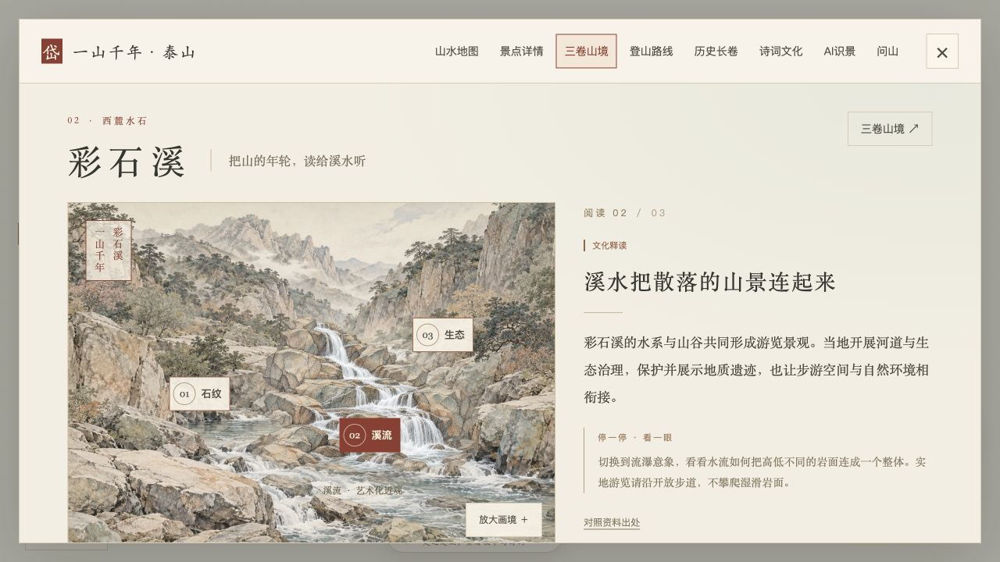
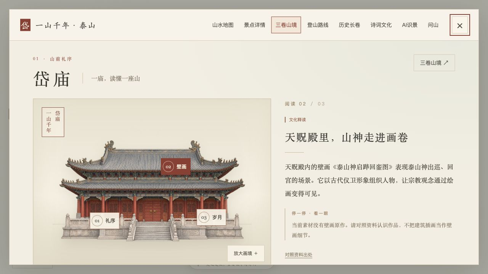

# 三卷山境：实施与发布记录

2026-10-15，融合分支 `codex/taishan-integration`，后端版本 1.6.0。

## 已交付

入口：[三卷山境](https://118.89.176.236/experience/#scenes)，也可使用 [8037 端口](http://118.89.176.236:8037/experience/#scenes)。地图顶栏新增“山境”，文化导航和素材图集均能进入。

| 场景 | 阅读点 | 使用的现有素材 |
| --- | --- | --- |
| 岱庙 | 礼序、天贶殿壁画、古柏与碑刻 | H-ND-15A 建筑透明图 |
| 彩石溪 | 石纹与地质、溪流与治理、赤鳞鱼生态 | H-BG-17 溪谷背景、H-NT-08 流瀑近观 |
| 后石坞 | 古松、元君庙祠宇、修炼传说 | H-ND-21-bg 山谷、H-ND-21 山岩建筑、H-NT-01 古松近观 |

共三个独立场景、九个阅读点。点击画境热点或阅读点按钮切换内容；可放大、复位、前后翻页、查看出处、真实 TTS 朗读、记录已读、收藏、查看足迹、打开相关景点/路线。后石坞没有随意拼接关联路线。

“追问仙子”带入当前景点及阅读点问题，由用户提交到现有 Coze 问答；关闭数字人回到原阅读点。网址保留场景及阅读点，可刷新、分享和用浏览器历史返回。阅读点按钮支持方向键、Home、End。

记录在服务端 SQLite 中按匿名会话保存，重复记录不增加计数；成功反馈以服务端响应为准，失败可重试，场景离开后取消过期请求/语音。保存阅读也增加该景点的足迹。清空足迹会同时清除阅读记录。HTTP 与 HTTPS 分别持久保存会话，修复访问 HTTPS 后 HTTP 无法覆盖 Secure Cookie 导致的记录丢失，保留原 HTTPS 会话和安全属性。两种界面在同一协议下共享记录。线上浏览器已实际验证 HTTP 保存完成后刷新仍为 1/3 已读且已收藏。

目录现在有 19 个景点，检索资料 34 条，新增 9 条场景资料支持按壁画、赤鳞鱼、古松、传说等主题检索。新增景点暂未收录实景照片，未加入自动视觉识别类别，也未添加未经核验的地图坐标。全套 57 张图仍可在图集访问，其中 43 张通过前端直接引用或场景配置参与交互，14 张仍以图集浏览为主。

## 文化资料与表达边界

| 资料 | 用途与核对情况 |
| --- | --- |
| [岱庙景点介绍 · 泰山管委会](https://tsgw.taian.gov.cn/art/2021/6/13/art_363479_10320189.html) | 已读正文；礼制、中轴、古柏与碑刻概述 |
| [山东泰安：一座因山而生的城市 · 泰安市发改委](https://fgw.taian.gov.cn/art/2026/1/26/art_339298_10312911.html) | 已读正文；壁画出巡回宫题材 |
| [彩石溪水利风景区 · 泰安市水利局](https://slj.taian.gov.cn/art/2024/12/12/art_354136_10296884.html) | 已读正文；水系、治理、赤鳞鱼栖息环境 |
| [泰山风景名胜区 · 泰安市文旅局](https://whlyj.taian.gov.cn/art/2024/1/2/art_69508_4676522.html) | 已读正文；西麓山水与彩石地貌概述 |
| [泰山古松 · 泰山管委会](https://tsgw.taian.gov.cn/art/2021/6/17/art_162237_10286454.html) | 已读正文；姊妹松、卧虎松及其景观位置 |
| [天烛峰景区 · 泰山管委会](https://tsgw.taian.gov.cn/art/2021/5/26/art_363479_10320185.html) | 官方检索摘要核对；直接读取正文超时；修炼故事明确作为传说 |
| [后石坞元君庙院落环境维护设计方案公告 · 泰山管委会](https://tsgw.taian.gov.cn/art/2026/7/8/art_250485_10324165.html?xxgkhide=1) | 已读正文；仅用于确认元君庙文化保护对象，不推导古代建筑年代或今日开放情况 |

素材为艺术化概念演绎。岱庙图不作为天贶殿测绘复原，没有壁画原作；古松图不用于辨认具体名木；后石坞为合成画境。三个场景不是实景全景或地理导航。没有训练模型，不增加 GPU 推理负担。深度史料、壁画真图、更多实景照片和专家审校仍可继续补充。

## 验收证据

- 前端 24 项自动测试通过；后端 30 项执行，29 项通过、1 项可选 CLIP 跳过。
- 生产构建通过；主脚本仍有 Vite 大于 500 kB 的体积提示，未把提示当成性能达标结论。
- 本地与线上浏览器验证热点、放大、阅读保存、收藏、网址恢复、追问预填及返回；真实 TTS 本地播放器可观测到播放进度。手机 390×844、桌面 1280×720 检查，无场景横向溢出；不代替真机麦克风或低端机测试。
- 独立 API 测试会话在生产完成三个场景的九次阅读及收藏，并复查服务端状态；没有清除用户会话。
- 生产实际调用 Coze 三问：岱庙壁画 13.56 秒、彩石溪赤鳞鱼 3.47 秒、后石坞传说 3.47 秒；均返回 `rag_llm`、来源且非拒答。这里是三次实测，不是平均响应时间或准确率评测。
- 生产 TTS 实测生成 33,264 字节 MP3，3.48 秒。最终兼容发布另验证 HTTPS 入口与主脚本哈希、HTTP 持久记录及 HTTPS 身份不变。原始脱敏结果见 [API 验证记录](cultural-scenes-api-verification.json)。
- 浏览器 HTTPS 曾出现间歇连接关闭，重新打开成功；CLI 在正常证书校验下验证 HTTPS 页面、接口与构建哈希，未禁用 TLS 或绕过证书警告。

手机与目录截图见 `screenshots/cultural-scenes/`。

## 发布与恢复

部署到 `/opt/taishan`，沿用 `taishan.service` 与 Nginx，不改密钥、其他站点或端口。初次发布前备份代码、入口、数据文件和 SQLite 一致快照到 `/opt/taishan/runtime/before-cultural-scenes-20261015/`；Cookie/景点配图兼容修订前另存 `/opt/taishan/runtime/before-cultural-scenes-polish-20261015/`。

发布校验 24 个文件 SHA-256，先更新脚本，再更新后端与数据，健康检查通过后原子替换沉浸页入口。旧哈希脚本保留以支持已打开标签页。服务器当前清单 `/opt/taishan/cultural-scenes-release-manifest.json`，本地副本见 [构建清单](cultural-scenes-release-manifest.json)。

数据库只新增 `scene_steps` 表，不替换运行库。恢复旧代码时可以保留该表；不要直接恢复数据库旧快照覆盖新产生的用户记录。恢复应先还原旧后端、资料与前端入口，再重启 `taishan.service` 并检查健康。当前密钥仍在服务器原环境文件中，不进 Git。
