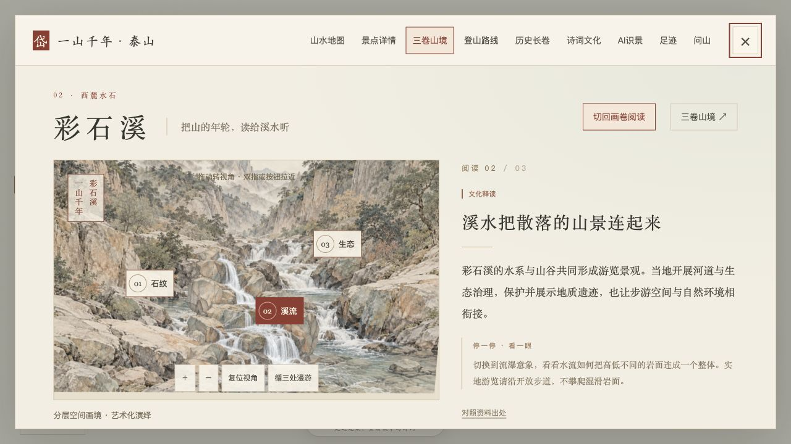

# 核心交互复审与空间漫游发布

2026-10-15，版本 1.7.0。依据用户提供的《方案.docx》《前端方案.docx》、`前端参考提取` 中 HTML 原型及三张截图，以及当前代码与实际操作逐项核对。沿用宣纸、浅绛山水、朱砂控件；用户追加的方向为尽量形成三维沉浸交互，精细建模交给建模师。

## 对照结果与本轮修复

| 页面/要求 | 复审发现 | 当前处理与边界 |
| --- | --- | --- |
| P01 欢迎/入山 | 已有欢迎、跳过、资源过渡；没有背景音乐 | 保留原版位置关系，不增加自动播放音乐；音量由用户触发的原生音频播放器控制 |
| P02 地图 | 搜索只能打开详情，不能直接定位；缩小时热点触控区域偏小 | 新增“定位/阅读”双入口，定位真实已有热点、放大并聚焦；无坐标场景只提供阅读。按地图和画面缩放补偿热区尺寸，正常与降级画面均处理 |
| P03 景点 | 沉浸详情不能直接收藏或独立朗读 | 接入真实收藏、服务端 TTS、原生暂停/进度/音量、语速；失败可重试；从章节进入可返回本章 |
| P04 路线 | 路线进入问山缺少显式上下文 | 新增带当前 route_id 的问山入口；关闭返回原路线及交通分支。真实路线顺序保留，实时票价/开放状态不臆造 |
| P05 历史 | 标签过于笼统 | 增加“文化传统概述/历史与遗产资料”分类；时代切换、原始出处、关联景点沿用已有实现。专业史学审校仍待完成 |
| P06 诗词 | 李白两首共十个显示行缺独立注释；只有设备语音，缺暂停/进度；诗句与阅读页签不保留 | 三首诗全部 22 个显示行有释读；新增诗人与作品页签、收藏；逐句选择与页签写入网址，手机可跳到释义再返回诗句 |
| P06 朗诵同步 | 无可复查的音频时间信息 | 三首诗使用服务端真实 MP3 与语音服务 WordBoundary 时间信息；原生暂停、拖动、音量及语速。高亮按 currentTime 与真实时间区间同步，点诗句可跳转。静态诗音缓存，不训练模型 |
| P07 识景 | 需回归格式校验、人工确认和错误状态 | 验证更换无效文件后清空旧预览、禁用开始；同时修复完整导览旧预览残留。公网实际识别经石峪并核验确认接口；不把单例当准确率 |
| P08 问山 | 诗词/路线上下文未完整传递；空白输入按钮可点击；关闭常回地图 | 显式 current_poem/current_route 连同网址恢复；空白输入禁用；关闭回到景点标签、诗句、阅读页签、路线或场景阅读点。停止、重试、清空、AI与摘录标记保留 |
| P08 知识同步 | 新诗句释读没有同步到旧检索文档 | 启动时从同一组诗词数据生成检索正文；具体诗句问题优先召回相关注释。避免界面有释义而问答仍引用旧全文；无效模型输出仍降级为有来源摘录 |
| 成长/足迹 | 两套界面割裂，沉浸页缺直接入口 | 新增 `#trail` 与 `#study`，真实足迹/景点与诗词收藏/五章任务进度；阅读前置与答案由原后端核验，答错不增加进度。不会根据前端点击生成虚假完成状态 |
| 场景体验 | 三卷山境是二维画面，缺视角交互 | 新增空间画境：Three.js 透视相机、拖动转视角、拉近/拉远、镜头热点、复位、巡览与画卷模式切换；离开释放渲染资源，失败保留阅读。当前素材层仍为平面图，属于分层空间表达 |
| 精细三维 | 没有三个场景的精细模型 | 已接 GLB/Meshopt 模型槽、PBR 灯光与命名热点；有效模型到位后切换完整模型并开放环绕。未加载模型时不请求不存在文件，加载失败回到分层画境。没有把临时测试几何当成正式模型发布 |
| P09/P10 后续 | 独立石刻图鉴/民俗专题未完成 | 完整导览已有三项文博介绍，尚无文物扫描、独立民俗专题或多语言；按原方案 P2 登记，不计作本轮已完成 |

## 参考与素材核对

- 读取两份 Word 正文，检查 `前端参考提取/界面/taishan_ui_preview/index.html` 的页面及交互；查看原地图截图与中天门详情参考图。沿用既有艺术方向，不搬入概念原型的假回答和 alert。
- `图片资产` 与 `图片资产解压` 各有 57 张 PNG，分别与素材清单 57 个 source_sha256 全部匹配，是同一套资源。当前 43 张参与直接页面/场景交互，14 张仍以图集浏览为主；“能在图集打开”不等于已做成独立三维场景。
- 诗词原文沿用既有公版来源；新增释读为项目原创短注，仍需文化专家复核。没有据游仙叙事构造真实历史、精确地理或现实交通方式。

## 运行入口

- [山水地图](https://118.89.176.236/experience/#map)
- [足迹与收藏](https://118.89.176.236/experience/#trail)
- [五章读山](https://118.89.176.236/experience/#study?id=gate)
- [诗词与朗诵](https://118.89.176.236/experience/#poetry?id=libai-2)
- [空间画境](https://118.89.176.236/experience/#scene?id=caishixi&point=water)

同路径也可经 `http://118.89.176.236:8037` 访问；麦克风需 HTTPS。HTTP 与 HTTPS 各自保持会话，同一协议下两套界面共享进度。

## 验证与证据

- 前端 26 项测试通过；后端 33 项执行、32 项通过、1 项可选 CLIP 跳过；生产构建通过；同一后端测试集也已在服务器运行，通过 32 项、跳过 1 项。主脚本仍有约 777 kB 未压缩体积提示，不声称已达到真实用户性能指标。
- 本地浏览器完整走完五章，先读景点、答错再答对、逐章完成，足迹显示 5/5；刷新与从详情返回保留状态。截图 `screenshots/core-audit/study-preview-complete.png` 为本地预览证据。
- 实际三首诗音频均生成，时间信息覆盖 4、12、6 个显示行。播放器实测点击第八个显示行后 currentTime 跳到约 23.55 秒，高亮对应“天门一长啸，万里清风来”；停止会释放音频。
- 手机 390×844 与桌面 1280×720 检查。手机诗句点击跳到释义，回到诗句后位于可视区域；页面没有横向溢出；地图在 100% 与 80% 缩放下实测热点高度均约 44 px；导航可横向滚动，不把九个栏目挤成小字。
- 空输入禁用、诗词/路线上下文、关闭问山回原页面均经浏览器验证。上传先选有效 WebP 再选 Markdown，旧预览清空且提交禁用。
- 空间画境验证转视角、缩放、复位、巡览及退出后 canvas 数量为 0。使用临时 GLB 测试加载分支与热点，测试文件已移除；正式三个精细场景模型均未到位。
- 公网 API 在独立匿名 QA 会话验证三首真实音频、五章任务、两个收藏、路线 Coze 与经石峪真实云端识景/人工确认；没有清除用户数据。第一次诗词模型响应触发安全降级，记录中如实保留 `local_knowledge_fallback`；随后修正旧资料同步和逐句检索，并补最终公网复查：5.50 秒返回 Coze `rag_llm`，分别引用羽人及鸟迹书两条释读，六行诗音缓存跨重启保留。详见 [接口证据](core-audit-api-verification.json)。

## 建模交付

详见 [场景建模交付规范](../modeling/场景建模交付规范.md)。建模师交付 `daimiao.glb`、`caishixi.glb`、`houshiwu.glb`，保留 `.blend`；每个场景有三个 `POI_*` 命名空物体。网页已实现文件检测、实际加载、视点投影和失败恢复。

精细建筑背面与内部、准确台阶与栏杆、山岩/水系几何和高质量贴图需要建模师按实景资料制作。当前视口是环绕/热点导览，没有内部第一人称行走、碰撞或真实导航，不把分层图片视差称为精细三维复原。

## 发布与回滚

沿用 `/opt/taishan`、`taishan.service`、HTTPS 与 8037；未改环境密钥、其他网站或模型权重。首次发布前一致备份 SQLite 和所改代码/数据/前端入口到 `/opt/taishan/runtime/before-core-audit-20261015/`，最后内容与触控修正另备份到 `/opt/taishan/runtime/before-core-audit-polish-20261015/`。

发布 14 个文件并逐一校验 SHA-256，保留旧哈希脚本供已打开页面使用；后端健康检查通过后替换入口。运行库未被覆盖，新诗音只缓存到 `runtime/poem-audio/`。服务器清单 `/opt/taishan/core-audit-release-manifest.json`。恢复旧代码时应保留运行数据库和新增用户记录，不用旧数据库快照覆盖当前数据。

仍待真实设备与人工工作：iOS/Android 麦克风权限和中文识别、真实慢网/低端机测量、至少 50 题跨专题人工文化核验、专家史料审校、完整三维场景资产、正式参赛录屏。自动测试不能代替这些结果。
